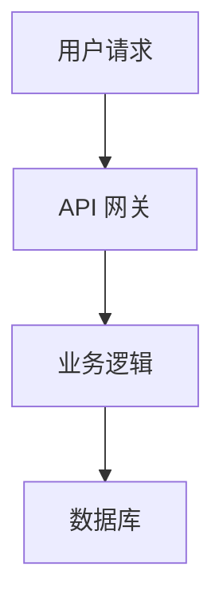

# Wechat Tech Writer

以技术专家视角，撰写深度技术文章。

## 工作流程

```
技术资料 → 深度分析 → 代码示例 → 架构图 → 成稿输出
```

## 使用方法

```bash
# 从技术文档
wechat-tech-writer --input api-docs.md

# 从代码仓库
wechat-tech-writer --repo https://github.com/xxx

# 指定技术栈
wechat-tech-writer --input docs.md --stack "Python, FastAPI"
```

## 写作框架

### 技术文章结构

```markdown
# 技术标题

## 背景与问题
- 技术背景
- 遇到的问题

## 技术方案
- 架构设计
- 核心原理
- 实现细节

## 代码示例
```python
# 核心代码
```

## 性能优化
- 瓶颈分析
- 优化方案
- 对比数据

## 最佳实践
- 踩坑经验
- 注意事项

## 总结
- 关键收获
- 未来展望
```

## 技术特点

### 1. 代码高亮
- 支持 50+ 语言
- 语法高亮
- 行号显示

### 2. 架构图
- Mermaid 流程图
- ASCII 图表
- 图片标注

### 3. 对比表格
| 方案 | 优点 | 缺点 |
|------|------|------|
| 方案A | ... | ... |

## 代码块规则

```markdown
# 标题
\`\`\`python
# 代码注释
def main():
    pass
\`\`\`

**输出：**
\`\`\`
result
\`\`\`
```

## 架构图示例



## 技术深度等级

| 等级 | 目标读者 | 内容特点 |
|------|----------|----------|
| 入门 | 初学者 | 概念为主，少量代码 |
| 进阶 | 工程师 | 原理 + 实践 |
| 高级 | 架构师 | 源码分析 + 性能优化 |

## 配图要求

- **架构图**：必须清晰
- **流程图**：逻辑完整
- **数据图**：真实数据

## 示例输出

**输入：** API 文档
**输出：** 技术深度文章

```markdown
# FastAPI 性能优化实战

## 背景
FastAPI 是现代 Python Web 框架...

## 核心原理
ASGI 服务器的工作机制...

## 性能优化

### 1. 异步 IO
\`\`\`python
async def get_data():
    result = await db.query()
    return result
\`\`\`

### 2. 连接池
配置数据库连接池...

## 基准测试
| 并发数 | QPS | 延迟 |
|--------|-----|------|
| 100 | 5000 | 20ms |
```

## 与 PM Writer 的区别

| 维度 | Tech Writer | PM Writer |
|------|-------------|-----------|
| 读者 | 工程师 | 产品/运营 |
| 重点 | 技术实现 | 业务价值 |
| 风格 | 深度、严谨 | 易懂、实用 |

---

**版本：** 1.0
**作者：** Alex
